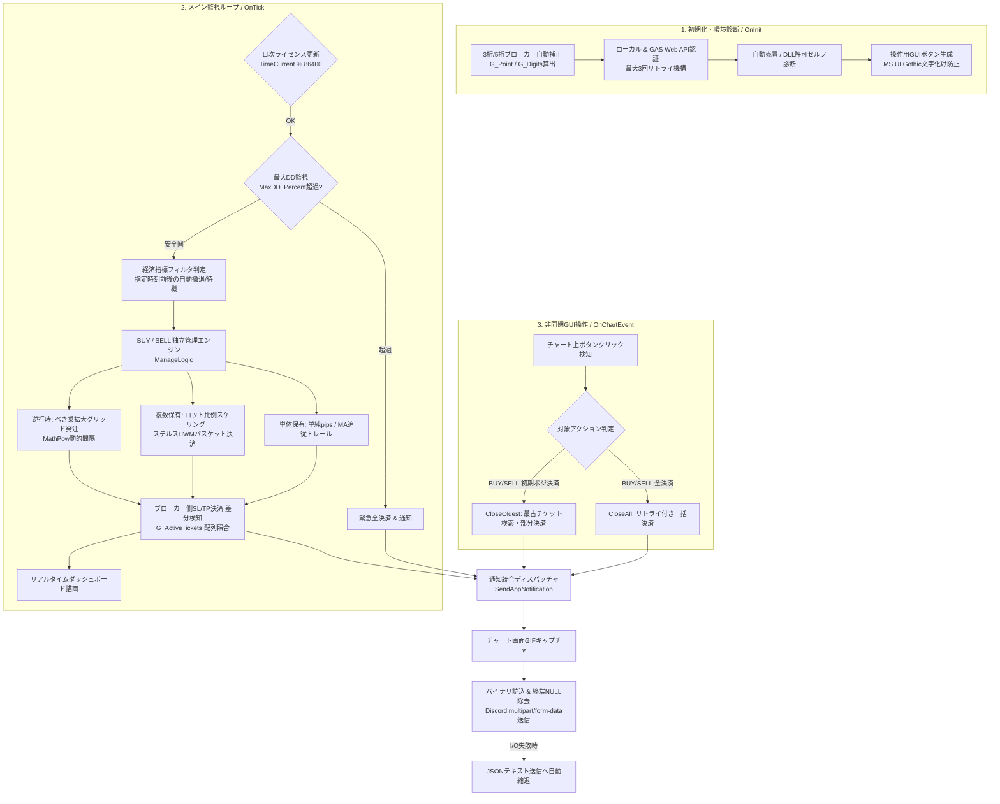

# AEGIS-Position-Manager (v4.00)
### ハイブリッド型 自動決済・動的資金管理システム（イベント駆動GUI / ステルス・バスケット制御）


MetaTrader 4 (MT4) 上で動作するハイブリッド型の自動決済・ポジション管理システム（EA）です。  
トレーダーの手動エントリー（裁量取引）や他の自動売買システムが保有したポジションをリアルタイムに検知し、相場状況に応じた利益の最大化（単体MAトレーリング＆複数ポジションのステルス・バスケット決済）、逆行時の救済（動的グリッド＆初期ポジ部分決済UI）、および多重防衛リスク管理（経済指標オートエスケープ・最大DD緊急停止）を全自動で実行します。

> **※ セキュリティおよび公開コードについて**  
> 本リポジトリで公開しているソースコードは実運用環境で稼働しているプロダクト（v4.00）のフルコードですが、セキュリティ保護の観点から、外部認証サーバー（Google Apps Script Web API）のエンドポイントIDのみプレースホルダー（`YOUR_GAS_DEPLOYMENT_ID_HERE`）に置換しています。

---

## 📸 実運用・稼働イメージ

### 1. チャート上ダッシュボード ＆ 非同期コントロールUI


### 2. Discordへの決済レポート（バイナリ画像＋損益結果）非同期配信


---

## 🏗 システムアーキテクチャ

MT4の3大イベントハンドラ（`OnInit` / `OnTick` / `OnChartEvent`）を軸に、状態監視・注文制御・外部API通信を非同期に連携させています。



---

## ⚙️ コアロジックとアルゴリズム設計

### 1. ハイブリッド・トレーリング決済（単体 ＆ 複数バスケット）
ポジションの保有数（単体か複数か）によって、内部で自動的に利益追従の方式を切り替えます。
* **単体保有時（`RunSingleTrail()`）**:
  * **単純追従モード (`MODE_SIMPLE`)**: 現在価格から指定pips離れた位置にストップロス（SL）を直接引き上げます。
  * **移動平均線追従モード (`MODE_MA`)**: トレンドの支持線となる移動平均線（`iMA`）の価格を基準にSLを更新し、相場のノイズによる早すぎる決済を防ぎます。
* **複数保有時・バスケット決済（`ManageLogic()`）**:
  * MT4の仕様上、複数ポジションの合計利益に対して1つのSL注文をサーバーに出せないため、EA内部メモリ（`HighWaterMark_Buy` / `Sell`）に合計利益の最高到達点を記録する**ステルス・トレーリング方式**を採用。
  * **残高％ × ロット・スケーリング機能 (`UseLotScaling`)**: 口座残高に対する指定％から基準目標額を算出し、さらに「現在の合計ロット数 ÷ 初期ポジションのロット数」の倍率（`lotMultiplier`）を動的に掛け合わせます。

```cpp
// ロット増加に比例して目標金額とトレール幅を動的に引き上げる計算式
double lotMultiplier = totalLot / initialLot;
double targetAmount  = baseTargetAmount * lotMultiplier;
double trailAmount   = baseTrailAmount  * lotMultiplier;
```

### 2. 動的グリッド（変則ナンピン）アルゴリズム
相場逆行時、一定間隔ではなく「ポジション数が増えるごとに次のエントリー間隔を広げていく」安全設計を採用しています。
* べき乗を計算する `MathPow()` 関数を使用し、初回間隔（`BaseGridPips`）に拡大係数（`GridCoef`）を乗算します。
* スプレッド制限（`MaxSpread`）および経済指標フィルター（`IsNewsPaused`）をクリアした安全な相場環境でのみ追撃注文（`OrderSend`）を実行します。

```cpp
// ポジション数(cnt)が増えるほど、次のナンピンまでの必要pips(gridPips)が指数関数的に広がる
double gridPips = BaseGridPips * MathPow(GridCoef, cnt - 1);
```

### 3. 多重防衛リスク管理（経済指標エスケープ ＆ 緊急停止）
* **経済指標オートエスケープ (`UpdateNewsStatus()`)**: 指定した指標発表時刻（`NewsTime`）の前後数分間を待機時間と判定。待機時間に入った瞬間、合計損益が許容範囲（`MaxLossForNews` 以上）であれば自動で全ポジションを決済して急変動リスクから撤退します。
* **ドローダウン緊急停止 (`CheckEmergencyStop()`)**: 口座残高に対する含み損の割合（`ddPercent`）を常時計算し、許容値（`MaxDD_Percent`）に達した瞬間に強制全決済を行い、口座資金の破綻を防ぎます。

---

## 💡 技術的な工夫・エンジニアリングハイライト

### 1. ブローカー側決済（SL/TP自然約定）のチケット配列・差分検知アルゴリズム
* **課題**: MQL4には「サーバー側でストップロス等に到達して決済された瞬間」を受け取る標準イベントが存在しない。
* **解決策**: 前回ティックで保有していたチケット番号の配列（`G_ActiveTickets`）と現在の保有チケット配列を毎ティック照合する差分検知ロジック（`CheckBrokerClosures()`）を実装。EA自身が `OrderClose()` を実行中であることを示す排他制御フラグ（`IsEACloseExecuting`）と組み合わせることで、EAによる能動決済とブローカー側の自然約定を厳密に区別し、通知の重複や漏れをゼロにしています。

### 2. Discord APIへの画像バイナリ送信と終端NULL文字（`\0`）の除去
* **課題**: 外部DLLに頼らず標準の `WebRequest()` のみでDiscordへ画像（`.gif`）をマルチパート送信する際、MQL4の文字列変換関数（`StringToCharArray`）が末尾に自動付与する終端NULL文字（`\0`）がDiscord側の厳格なパーサーに弾かれ、HTTP 400エラーを引き起こす。
* **解決策**: 配列サイズを `-1` して終端NULL文字を明示的に切り詰めるバッファ操作を実装し、バイト単位で `multipart/form-data` ボディを結合。また、VPSの負荷等で画像生成や送信に失敗した場合でも、自動的にテキストのみの送信（`SendDiscordText()`）へ切り替わるフォールバック設計を組み込んでいます。

### 3. Web API（GAS）認証における日次キャッシュ軽量化とフェイルセーフ
* **課題**: 毎ティック外部サーバーへHTTPリクエストを送ると通信負荷により約定遅延が発生する。
* **解決策**: 日付の切り替わり（`TimeCurrent() % 86400`）を検知して「1日1回のみ」再認証を行う設計に最適化。バックテスト時（`IsTesting()`）は通信を自動スキップして検証速度を維持し、実運用時の一時的なネットワーク瞬断に対しては最大3回のリトライ猶予（`MaxAuthRetries`）を持たせています。

### 4. 救済のための「初期ポジション狙い撃ち部分決済」UI
* `CloseOldest()` 関数とチャート上の非同期GUIボタンを連携させ、複数ポジション保有中に最も含み損が大きくなりやすい「一番最初にエントリーした最も古いポジション（`OrderOpenTime()` が最小のチケット）」だけをピンポイントで検索・決済する機能を実装。海外製VPS環境での文字化けを防ぐため `MS UI Gothic` フォントを明示指定しています。

---

## 🛠 開発プロセス（Development Methodology）

本システムは、実運用における資金管理および決済オペレーションの自動化を目的とし、**AI-Assisted Development（生成AIをペアプログラマーとして活用した開発手法）**を取り入れて開発しました。

* **要件定義・アルゴリズム設計**:  
  取引現場で直面する課題（指標発表時の急変動リスク、ナンピン時の目標利益とロットの不均衡、サーバー約定時の通知漏れ）を洗い出し、ロット比例スケーリングやチケット差分検知などの仕様を自身で設計。
* **実装・プロトタイピング**:  
  MQL4の非同期イベント制御（`OnChartEvent`）や動的配列操作、HTTP通信周りの実装にLLMを活用し、高速なプロトタイピングを実現。
* **デバッグ・品質改善**:  
  実環境テストで発生した「Discord送信時のHTTP 400エラー（終端NULL文字混入）」や「手動決済とサーバー決済の二重通知バグ」に対し、通信ログ解析および排他フラグ制御の導入を主導して解決。

---

## 📋 主要関数リファレンス

| 関数名 | 役割・処理内容 |
| :--- | :--- |
| `CheckLicense()` | マクロ定義された口座番号・ブローカー名・有効期限のローカル照合を行う。 |
| `CheckWebAuthentication()` | 外部Web API（GAS）へGETリクエストを送りオンライン認証を行う（日次更新・リトライ機能付き）。 |
| `ManageLogic(int type)` | 買い・売り別のメイン管理関数。ポジション集計、指標逃避、バスケット決済、変則ナンピン発注を統括する。 |
| `RunSingleTrail(...)` | 単体ポジション保有時に、単純pipsまたは移動平均線（MA）を基準にSL（逆指値）を変更する。 |
| `CloseAll(int type)` | 指定方向の全ポジションを決済する。約定拒否対策として最大3回のリトライ処理（`Sleep(500)`）を内蔵。 |
| `CloseOldest(int type)` | 指定方向のうち、保有時間が最も古い（初期エントリーの）ポジション1つのみを検索して決済する。 |
| `CheckBrokerClosures()` | 保有チケットの履歴配列を比較し、サーバー側でのSL/TP決済を差分検知して通知をトリガーする。 |
| `CheckEmergencyStop()` | 口座残高に対する含み損率（ドローダウン）を計算し、閾値超過時に全ポジションを強制決済する。 |
| `UpdateNewsStatus()` | PCローカル時間と指定の経済指標時間を比較し、新規ナンピン停止＆事前決済フラグを制御する。 |
| `SendAppNotification(...)` | MT4プッシュ通知とDiscord通知（画面キャプチャ撮影＋送信）を統合管理する。 |
| `SendDiscordImage(...)` | 撮影したチャート画像をバイナリデータとして読み込み、マルチパート形式でDiscordへPOST送信する。 |
| `SendDiscordText(...)` | 画像送信失敗時のバックアップとして、JSON形式でテキストメッセージのみをDiscordへPOST送信する。 |
| `CalculateTodayProfit()` | 口座履歴（`MODE_HISTORY`）を走査し、当日決済された対象ポジションの確定損益合計を算出する。 |
| `CreateUIButtons()` | チャート上の指定コーナー・座標に、手動決済用の4つの操作ボタンを描画する。 |
| `UpdateDashboard()` | チャート左上に、確定利益・動的目標額・保有状況・回収モード状態をリアルタイム描画する。 |

---

## 📁 ディレクトリ構成

```text
AEGIS-Position-Manager/
│
├── assets/                        # 実運用スクリーンショット格納用
│   ├── aegis_chart_ui.png         # チャート画面（ダッシュボード＆操作UI）
│   └── aegis_discord_notify.png   # Discord画像付き決済通知
│
├── src/
│   └── AEGIS_Pro_Manager.mq4      # メインソースコード（v4.00 / 認証IDマスク済）
│
└── README.md                      # システム仕様・アーキテクチャ設計書
```
